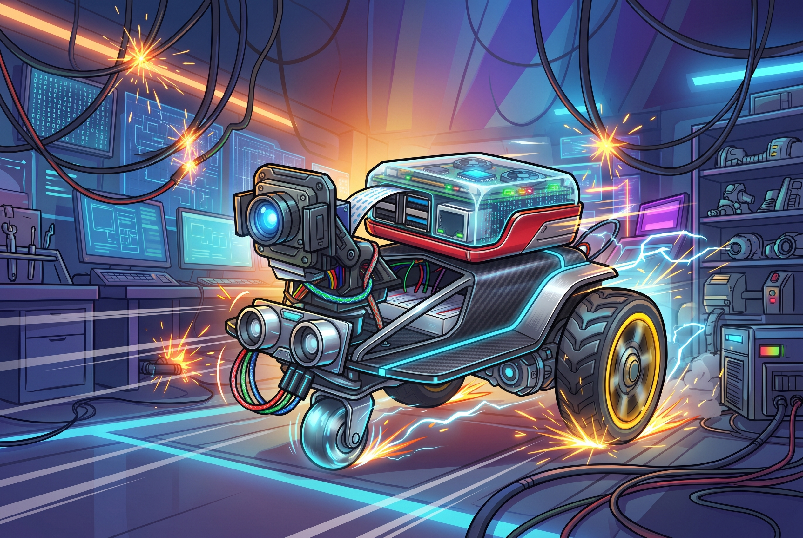

# MCT443s — Autonomous Mobile Robot (AMR)

<p align="center">
  
</p>

<p align="center">
  <strong>Design • Simulation • Autonomous Navigation • Real-World Deployment</strong>
</p>

<p align="center">
  
  
  
  
  
</p>

---

## 1. Project Overview

The **Autonomous Mobile Robot (AMR)** is a mobile robotics project developed as part of the **MCT443s – Design of Autonomous Systems** course.

The project focuses on designing and developing an autonomous ground vehicle capable of navigating a predefined road environment, following lane markings, detecting obstacles, and performing autonomous lane-switching maneuvers.

The system combines computer vision, sensor feedback, localization, and motion control within a ROS 2-based architecture.

The robot will first be modeled and tested in a Gazebo simulation environment before being deployed and evaluated on a custom-built physical platform.

### Main Objectives

- Develop an autonomous mobile robot platform.
- Implement camera-based lane detection and tracking.
- Achieve stable navigation using IMU feedback.
- Detect obstacles and determine safe navigation paths.
- Perform autonomous lane switching.
- Integrate perception, localization, and control using ROS 2.
- Validate the system through simulation and physical testing.

---

## 2. Project Tasks

The project is divided into two main autonomous navigation tasks.

### Task 1 — Autonomous Lane Following

**Objective:** Develop an autonomous lane-following system capable of tracking the center of a straight road while maintaining heading stability.

**Environment Specifications:**

| Parameter | Specification |
|---|---|
| Road Length | 10 meters |
| Number of Lanes | 1 |
| Lane Width | 40 cm |
| Navigation Mode | Autonomous |
| Main Sensors | RGB Camera + IMU |

**Required Functionality:**

- Detect road boundaries and lane markings using computer vision.
- Estimate the centerline of the road.
- Calculate lateral deviation from the desired trajectory.
- Maintain stable heading using IMU feedback.
- Generate steering and velocity commands.
- Follow the lane throughout the complete track.

### Task 2 — Obstacle Avoidance & Lane Switching

**Objective:** Develop an autonomous navigation system capable of detecting static obstacles and changing lanes safely without crossing road boundaries.

**Environment Specifications:**

| Parameter | Specification |
|---|---|
| Road Length | 10 meters |
| Number of Lanes | 2 |
| Lane Width | 40 cm per lane |
| First Obstacle | 4 meters — Right Lane |
| Second Obstacle | 8 meters — Left Lane |
| Navigation Mode | Autonomous |

**Required Functionality:**

- Detect obstacles using ultrasonic or LiDAR sensors.
- Estimate obstacle distance and relative position.
- Determine whether the current lane is blocked.
- Identify a safe alternative lane.
- Execute smooth lane-switching maneuvers.
- Maintain road boundaries during navigation.
- Return to the appropriate lane when safe.

---

## 3. Robot Platform & Hardware

The project uses a custom-built four-wheeled mobile robot designed for autonomous navigation and real-world testing.

### Vehicle Specifications

| Component | Description |
|---|---|
| Vehicle Type | Four-wheeled mobile robot |
| Drive Configuration | Rear-wheel drive |
| Maximum Width | Less than 30 cm |
| Drive Motors | DC geared motors |
| Steering | Front steering mechanism |
| Processing Unit | Raspberry Pi / Jetson Nano / ESP32 + Laptop |
| Power System | Battery-powered platform |

### Sensors & Electronic Components

| Component | Purpose |
|---|---|
| RGB Camera | Lane detection and visual perception |
| IMU | Heading estimation and orientation feedback |
| Ultrasonic / LiDAR | Obstacle detection and distance measurement |
| Wheel Encoders | Wheel speed measurement and odometry |
| Motor Drivers | Motor actuation and speed control |
| Embedded Controller | Low-level hardware interfacing |

*Final hardware configuration is subject to the selected components and implementation.*

---

## 4. Software Architecture

The software is designed around ROS 2, with independent nodes responsible for perception, localization, control, and hardware communication.

### System Pipeline

```text
        Sensors & Inputs
               |
       +-------+-------+
       |               |
     Camera          IMU
       |               |
       v               v
+-----------------------------+
|       Perception Layer      |
|                             |
|  Lane Detection             |
|  Obstacle Detection         |
+-----------------------------+
               |
               v
+-----------------------------+
|      Localization Layer     |
|                             |
|  Odometry                    |
|  Heading Estimation         |
|  Sensor Feedback            |
+-----------------------------+
               |
               v
+-----------------------------+
|        Control Layer        |
|                             |
|  Lane Following             |
|  Steering Control           |
|  Speed Control              |
|  Lane Switching             |
+-----------------------------+
               |
               v
+-----------------------------+
|       Hardware Layer        |
|                             |
|  Motor Drivers              |
|  Steering Actuation         |
+-----------------------------+
               |
               v
        Mobile Robot
```

### Main Software Components

| Component | Responsibility |
|---|---|
| ROS 2 | Communication and system integration |
| Gazebo | Robot and environment simulation |
| URDF / Xacro | Robot description and modeling |
| OpenCV | Image processing and lane detection |
| Python / C++ | Algorithm development |
| MATLAB / Simulink | Mathematical modeling and controller analysis |

---

## 5. Repository Structure

The repository is organized into modular ROS 2 packages to maintain separation of concerns and simplify development.

```text
Autonomous-Mobile-Robot/
│
├── README.md
├── LICENSE
├── cover.png
│
├── ros2_ws/
│   └── src/
│       │
│       ├── amr_description/
│       │   ├── urdf/
│       │   ├── meshes/
│       │   └── config/
│       │
│       ├── amr_gazebo/
│       │   ├── worlds/
│       │   ├── models/
│       │   └── launch/
│       │
│       ├── amr_perception/
│       │   ├── amr_perception/
│       │   ├── config/
│       │   └── launch/
│       │
│       ├── amr_localization/
│       │   ├── amr_localization/
│       │   ├── config/
│       │   └── launch/
│       │
│       ├── amr_control/
│       │   ├── amr_control/
│       │   ├── config/
│       │   └── launch/
│       │
│       ├── amr_hardware/
│       │   ├── amr_hardware/
│       │   ├── config/
│       │   └── launch/
│       │
│       └── amr_bringup/
│           ├── launch/
│           └── config/
│
├── matlab_simulink/
│   ├── models/
│   ├── controllers/
│   └── analysis/
│
├── docs/
│   ├── images/
│   ├── diagrams/
│   └── documentation/
│
└── media/
    ├── simulation/
    └── hardware/
```

---

## 6. Development Workflow

The development process follows a modular workflow:

1. **Robot Modeling:** Define the robot dimensions, mechanical configuration, and sensor placement.
2. **Simulation:** Build the robot model and create the required road environments in Gazebo.
3. **Perception:** Develop and test lane and obstacle detection algorithms.
4. **Localization:** Integrate IMU and encoder feedback for heading and odometry estimation.
5. **Control:** Implement steering, velocity, lane-following, and lane-switching controllers.
6. **Integration:** Connect all ROS 2 nodes and validate inter-node communication.
7. **Hardware Deployment:** Interface the control system with the physical robot.
8. **Testing & Evaluation:** Compare simulation and real-world performance.

---

## 7. Installation & Setup

### Prerequisites

- Ubuntu Linux
- ROS 2 (selected distribution: Humble or Jazzy)
- Gazebo compatible with the selected ROS 2 distribution
- Python 3
- OpenCV
- Colcon build tools
- Git

### Clone the Repository

```bash
git clone <YOUR_REPOSITORY_URL>
cd Autonomous-Mobile-Robot
```

### Build the ROS 2 Workspace

```bash
cd ros2_ws

source /opt/ros/<ROS_DISTRO>/setup.bash

rosdep install --from-paths src --ignore-src -r -y

colcon build --symlink-install

source install/setup.bash
```

Replace `<ROS_DISTRO>` with your installed ROS 2 distribution, such as `humble` or `jazzy`.

### Verify the Workspace

```bash
ros2 pkg list | grep amr
```

---

## 8. Running the Project

The project supports two main execution environments:

### Gazebo Simulation

Simulation is intended for developing and validating the robot behavior before physical deployment.

The simulation environments will include:

- Single-lane road for Task 1.
- Two-lane road with static obstacles for Task 2.
- Robot model with simulated sensors.
- Visualization of navigation and control behavior.

### Physical Robot

The hardware deployment will use the embedded processing unit, camera, IMU, distance sensors, encoders, and motor control electronics.

*Launch commands will be documented here after the corresponding launch files and hardware interfaces are implemented.*

---

## 9. Performance Evaluation

The robot will be evaluated based on measurable navigation performance.

| Evaluation Metric | Purpose |
|---|---|
| Lateral Error | Measures deviation from the lane center |
| Heading Error | Measures orientation deviation |
| Lane Detection Accuracy | Evaluates visual perception |
| Obstacle Detection Accuracy | Evaluates obstacle recognition |
| Lane Switching Time | Measures maneuver execution time |
| Trajectory Smoothness | Evaluates navigation stability |
| Completion Time | Measures overall task performance |

Quantitative results, simulation screenshots, and physical testing videos will be added as the implementation progresses.

---

## 10. Project Status

<details>
<summary><strong>Development Progress</strong></summary>

| Module | Status |
|---|---|
| Robot Mechanical Design | In Progress |
| URDF / Xacro Modeling | Planned |
| Gazebo Simulation | Planned |
| Lane Detection | Planned |
| Obstacle Detection | Planned |
| IMU Integration | Planned |
| Odometry | Planned |
| Lane Following Controller | Planned |
| Lane Switching Controller | Planned |
| ROS 2 Integration | Planned |
| Physical Deployment | Planned |
| Performance Evaluation | Planned |

</details>

---

## 11. Team & Acknowledgment

Developed as a collaborative academic project for:

**MCT443s — Design of Autonomous Systems**

The project involves the integration of mechanical design, embedded systems, robotics, computer vision, simulation, and autonomous control.

---

## 12. License

This project is distributed under the license specified in the repository's `LICENSE` file.

---

<p align="center">
  <strong>Autonomous Navigation Starts Here.</strong>
  <br>
  Built with ROS 2, Robotics, and Engineering.
</p>
